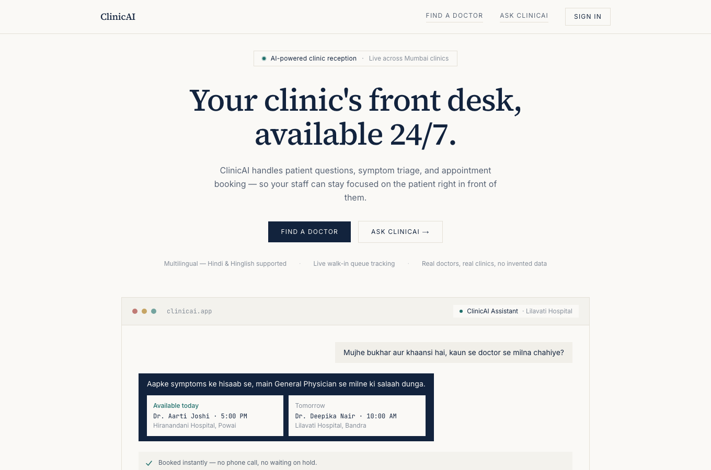
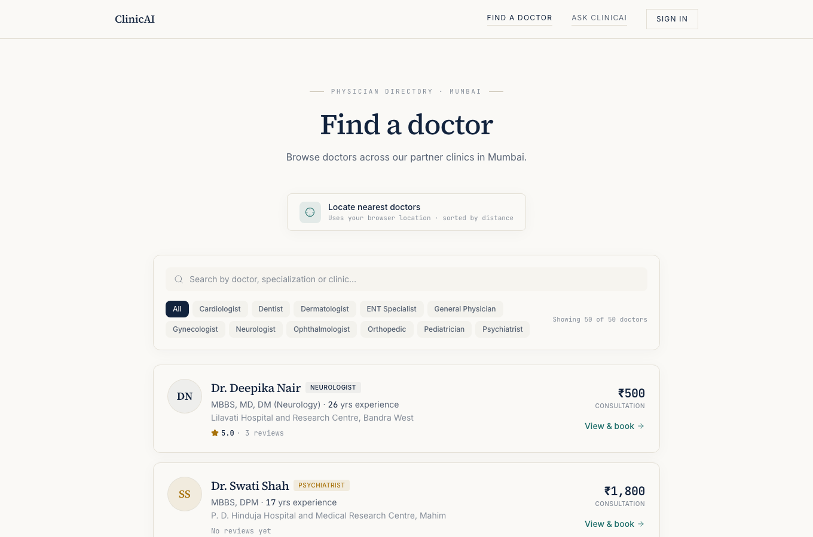

# ClinicAI

**An AI-powered front desk for clinics.** Patients find a doctor, ask questions in plain language (English, Hindi or Hinglish), book a slot and pay a deposit. Clinic staff run the day from a dashboard with appointments, a live walk-in queue and analytics.

**Live demo:** https://clinicai-555888.vercel.app

| Home | Find a doctor |
|---|---|
|  |  |

## Problem

Small and mid-size clinics lose time and patients at the front desk. Staff answer the same questions about timings, fees and parking all day, patients do not know which specialist to see for their symptoms, double-booked slots cause conflict, and walk-in patients have no idea how long they will wait. ClinicAI automates the repetitive part of reception and keeps humans for the patient in front of them.

## Key features

**For patients**
- **Ask ClinicAI:** a chat assistant that answers clinic FAQs, recognises emergencies, and suggests the right specialty from a description of symptoms, then shows doctors with open slots.
- **Find a doctor:** search by name, specialty or clinic, filter by specialty, and sort by distance with "nearest doctors" (browser location).
- **Booking:** pick a date and slot, book a scheduled visit or join the walk-in queue, and pay a deposit through Razorpay (test mode).
- **My appointments:** view and cancel bookings; QR check-in at the clinic.
- **Reviews and ratings** for doctors.

**For clinic staff** (roles: `ADMIN`, `RECEPTION`)
- **Dashboard:** today's appointments, doctor roster and estimated waiting times.
- **Live queue:** call, skip and complete walk-in patients, with an audit log of every queue action.
- **Doctor management:** profiles, weekly availability and leave.
- **Analytics:** appointment KPIs and per-doctor numbers.
- **Staff invites, clinic FAQs and settings.**
- **Reminder emails:** a scheduled job emails patients before their appointment.

## Tech stack

| Layer | Technology |
|---|---|
| Framework | Next.js (App Router), React, TypeScript |
| Styling | Tailwind CSS |
| Database | PostgreSQL with Prisma ORM and SQL migrations |
| Auth | Clerk (sign-in, sign-up, webhook sync) |
| Payments | Razorpay (deposit orders and signature verification) |
| AI | Rule-based triage plus an LLM classifier (Groq) as fallback |
| Email | Resend (REST API) |
| Validation and logging | Zod, Pino |
| Hosting | Vercel (with a cron job for reminders) |

## Architecture

```
Browser (Next.js pages)  ->  Route handlers (src/app/api/*)
                                  |
                          Controllers  (validate input with Zod, shape responses)
                                  |
                           Services    (business rules, AI orchestration)
                                  |
                         Repositories  (Prisma queries)
                                  |
                              PostgreSQL

External: Clerk (identity + webhooks), Razorpay (payments), Groq (LLM), Resend (email)
```

- `src/app`: pages (`find`, `doctors/[id]`, `chat/[clinicId]`, `my-appointments`, `checkin/[token]`, `dashboard/*`) and `api/*` route handlers.
- `src/server`: layered backend (`controllers`, `services`, `repositories`, `middleware` for auth and role checks, `lib`).
- `prisma/schema.prisma`: 15 models, including `Clinic`, `Doctor`, `Availability`, `DoctorLeave`, `Patient`, `Appointment`, `QueueEntry`, `QueueAuditLog`, `Conversation`, `Message`, `Review` and `FAQ`.

**How the AI receptionist works** (`src/server/services/orchestrator.service.ts`): each message is first checked for emergency phrases (the reply tells the user to seek urgent care), then for greetings, FAQ topics and booking intent. Symptom descriptions are matched to a specialty by keyword rules; when the rules do not match, an LLM classifier (Groq) picks the specialty. The assistant never diagnoses: it routes patients to a doctor.

## Getting started

**Requirements:** Node.js 20+, a PostgreSQL database, and free test accounts for Clerk and Razorpay.

```bash
git clone https://github.com/lakshay-sketch/clinicai.git
cd clinicai
npm install               # also runs `prisma generate`
cp .env.example .env      # then fill in the values (see the table below)
npx prisma migrate deploy # create the tables
npx prisma db seed        # optional: load demo clinics and doctors
npm run dev               # http://localhost:3000
```

Other scripts: `npm run build`, `npm run start`, `npm run lint`.

### Environment variables

Create a `.env` file in the project root. **Never commit it** (it is gitignored). Names only:

| Variable | Purpose |
|---|---|
| `DATABASE_URL` | PostgreSQL connection string |
| `NEXT_PUBLIC_CLERK_PUBLISHABLE_KEY` | Clerk publishable key |
| `CLERK_SECRET_KEY` | Clerk secret key |
| `CLERK_WEBHOOK_SECRET` | Verifies Clerk webhooks (Svix) |
| `RAZORPAY_KEY_ID` | Razorpay key id (use test mode) |
| `RAZORPAY_KEY_SECRET` | Razorpay key secret |
| `NEXT_PUBLIC_RAZORPAY_KEY_ID` | Razorpay key id for the browser checkout |
| `GROQ_API_KEY` | LLM classifier (optional; the assistant still works with rules only) |
| `RESEND_API_KEY` | Reminder emails (optional) |
| `CRON_SECRET` | Protects `/api/cron/send-reminders` |
| `NEXT_PUBLIC_APP_URL` | Public base URL of the app |
| `CLINIC_TIME_ZONE` | Optional clinic time zone |

## Demo data

The seed data (`seed-data.json`) uses real, publicly listed Mumbai hospital names and addresses. Doctor names, fees, ratings, schedules, patients and appointments are **synthetic demo data**. Clinic contact emails and phone numbers are placeholders.

## Project status and limitations

- Portfolio / college project. Payments run in Razorpay **test mode** only; no real money moves.
- The assistant is a triage and routing aid, not medical advice.
- Reminder emails depend on a verified Resend domain; without one, delivery is limited to the sandbox.
- Automated tests are limited: the repository has no unit-test suite on `main`.

## Author

Built by [Lakshay Munjal](https://github.com/lakshay-sketch), B.Tech Computer Engineering, MPSTME (NMIMS), Mumbai.
